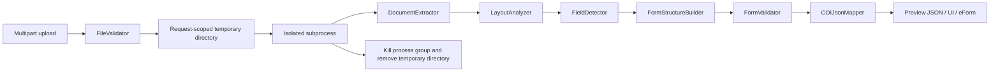

> Current official COI extension: `coi_standardizer.py` -> `coi_mapper.export_bundle()` -> `COIFormAdapter` -> published schema + recursive compatibility + business validation. The original editable model and explicit preview path are preserved. See `docs/OFFICIAL_COI_ANALYSIS.md` and `docs/COI_COMPATIBILITY_REPORT.md`; preview-only statements in the original architecture below are historical.

# FormForge — architecture

## Document AI upgrade

Existing pipeline and endpoints remain. `geometry.py` adds conservative vector
and raster blank regions; layout associates above/left labels, detects columns,
roles and repeated headings. SourceReference now distinguishes label/input bbox.
`ocr.py` bounds preprocessing candidates and total per-page OCR time, ranks
recognized quality without field-name or expected-output lookups, restores
coordinates after scaling/deskew and reports low-confidence regions.

`dictionaries.py` holds explicit local registry/matching and proposed catalogs;
`conditions.py` resolves only explicit instructions. Form now supports groups,
section conditions, conditional requiredness, initial_data and score semantics.
Combined reference/dependency checks reject cycles; parent group hierarchy is
validated. No official dictionary IDs or legal dependencies are inferred.

Optional `local_ai.py` is a small self-authored MIT Naive Bayes role classifier,
not an LLM. JSON model/proposals are Pydantic validated; model execution cannot
produce labels or source text. Missing/invalid models fall back. Mapping remains
preview; `mapping_config.py` supports local JSON Schema-backed mapping once real
fixtures exist and rejects external schema references. It is not a COI schema.

Frontend extensions `editor.js` and `source_mapping.js` augment existing UI.
Source uses the existing local Blob and reconstructed blocks; no new source
storage service is introduced. Detailed final status and limitations are in
`docs/COMPETITION_READINESS.md`; frozen evaluation is independent of demo code.

## Data flow

1. `file_validator.py`: filename, extension, MIME and magic/container checks,
   archive size/entry limits, XML DTD/entity and macro rejection. Does not extract
   archive paths to disk. Generic binary MIME is accepted only after real content validation.
2. `extractors.py`: typed `ExtractedDocument` with pages and ordered text blocks.
   PDFium supplies text rectangles and rasterization; pypdf supplies AcroForm
   annotations. Native form labels take precedence over repeated printed labels.
   DOCX retains paragraph/table order and explicit page breaks. XLSX/ODS formulas
   are preserved as metadata, never evaluated. OCR is Tesseract + local traineddata.
3. `layout_analyzer.py`: conservative heading recognition; PDF/OCR blocks sorted
   by vertical and horizontal position. No assumption that every capitalized field
   label is a heading. Multi-column reading order remains approximate.
4. `field_detector.py`: document-native field metadata, visual blank markers,
   Polish type rules, explicit option markers and label/blank cell pairs.
   No lookup of demo filenames, expected-fields files, or prepared outputs.
5. `structure_builder.py`: title, source pages, section order, static instructions
   and field references. Explicit simple conditions are linked by actual labels
   and values. Ambiguous dependency sentences become review warnings.
6. `form_validator.py`: structural review issues and independently validated test
   values. Required, type, date, PESEL date/checksum, email, phone, postal code,
   numeric bounds, lengths, dictionary membership and visibility conditions.
7. `coi_mapper.py`: internal export envelope with explicit incompatibility status.
   The `OfficialAdapter` protocol keeps real COI mapping separate and validates
   its output. No invented official schema.

## Intermediate model

Pydantic v2 models use `extra=forbid` and finite numeric values. `Form` contains
`Page`, `Section`, `FormField`, `ValidationRule`, `ConditionalRule`,
`DictionaryReference` and review warnings. Fields have stable content-derived IDs,
labels, types, required flags, ordering, page/section references, validation,
source text and location, confidence and detection method. Unknown values are
never populated. Reference consistency and duplicate IDs are checked; cyclic
conditions and excessive condition depth are rejected.

Source block IDs and provenance survive manual label/type edits. A user edit
does not increase extraction confidence. Choices found in the document are
`source=document`; edited option lists are `source=proposed`. No official
dictionary identity is guessed. Pages are source/logical pages, not a claim to
have redesigned an administrative workflow according to unavailable COI rules.

## API and UI

`main.py` hosts REST, server-rendered HTML and local static files. No large frontend
framework, package build, CDN, analytics or external service is required. Swagger
5.31.0 assets are vendored with their license. Multipart input is bounded before
parsing and exactly one uploaded file is accepted. `POST /convert` returns actual
stage durations after processing; the UI does not fabricate per-stage progress.

The browser maintains the edited intermediate model and export in memory. Its
download is generated from that current JSON. PDF/image preview uses a Blob URL;
the server never needs to retain the original. Other formats have an explicit
reconstructed text view. `eform.js` builds inputs with DOM APIs/textContent,
native validation and conditional visibility; it never executes document text.
Preview validation calls only this local API. The standalone preview HTML also
works with local assets, with browser validation; in the main UI the API is the
authoritative value validator. No citizen answers are stored.

## Process lifecycle and resource controls

Only the request owns the temporary directory. The worker has that directory as
`TMPDIR`/`TMP`/`TEMP`, including all pytesseract scratch files. The parent waits
with a wall-clock deadline and kills the entire process group on timeout,
cancellation or completion, then exits `TemporaryDirectory` and closes the upload.
Subprocess arguments use `create_subprocess_exec`, with no shell interpolation.
Secrets for JWT are removed from the worker environment. Its auth is disabled
because it does not serve HTTP.

Workers are bounded by an async semaphore; a full queue produces 429 instead of
an unbounded backlog. Linux also imposes `RLIMIT_CPU` and `RLIMIT_AS`. Container
limits apply to the whole service. macOS omits the address-space limit because
its behavior is not portable. Document complexity is bounded by ZIP sizes, page,
cell, block and pixel limits. Large nested XML is validated safely before readers.

There is no database, history, document cache or background persistence. Normal
exceptions, OCR timeout, worker termination and request cancellation are covered.
An ungraceful kill of the API process/host cannot execute Python cleanup; use
ephemeral container tmpfs for this lifecycle and avoid persistent temp mounts.
The frontend and API provide reviewable detection, not automated legal decisions.

## Extension points and production gaps

Local inference can rerank/augment field proposals with provenance and review
flags without becoming a prerequisite for startup. It must use local weights and
permissive licenses. No model download path currently exists in product code.

Competition readiness needs actual COI fixtures and rules, verified DOC conversion,
held-out extraction benchmarks, robust complex-layout handling, and a tested
container image with a complete SBOM. This MVP does not include a public identity
provider, tenant isolation, rate limiting across clients, an official submission
workflow, a competition slide deck, or a video.
