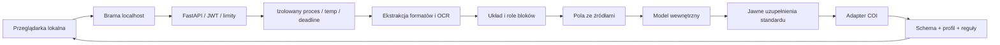

# FormForge 1.1 — architektura

Smart Workspace ma cztery oddzielne ekrany. `journey.js` steruje widocznością i przenosi istniejący DOM źródła/podglądu przy zmianie trybu. Prosty panel właściwości synchronizuje kanoniczny `editor.js`; nie tworzy drugiego modelu. `quality_review.metrics` osobno liczy źródło, model, eksport oraz pochodzenie warunków i rekurencyjne stany.

Istniejące API FastAPI oraz Jinja/własny JavaScript zostały rozwinięte, nie zastąpione.
Domyślnym wynikiem jest oficjalny COI FormDefinition. Dawny JSON preview pozostaje
jawną opcją `export_format=preview`; nie jest przedstawiany jako oficjalny eksport.

## Moduły i zakres

| Warstwa | Kod | Odpowiedzialność |
|---|---|---|
| Wejście | main.py, file_validator.py, config.py | pojedynczy plik, MIME/signatura/container, nazwa, rozmiar, JWT, bounded request |
| Cykl życia | main.run_worker, worker.py | semafor, proces i grupa potomna, wall deadline, RLIMIT, cleanup temp |
| Czytniki | extractors.py, docx_reader.py, legacy_doc.py, pdf_text.py | tekst/AcroForm, DOCX tabele/textboxy, ograniczony Word97, arkusze |
| OCR/układ | ocr.py, image_tiles.py, geometry.py, layout_analyzer.py | lokalny Tesseract, preprocessing, tile offset, source-space, skojarzenia etykiet |
| Semantyka | document_understanding.py, field_detector.py, conditions.py | role, typy, dowody, ograniczone warunki i ostrzeżenia |
| Opcjonalny model | local_ai.py, data/block_roles.json | własny mały Naive Bayes; fallback przy braku/uszkodzeniu, brak remote download |
| Model | models.py, structure_builder.py | strony, sekcje, pola, grupy, słowniki, conditions, initial_data, COIHints |
| COI | coi_standardizer.py, coi_official.py, coi_mapper.py, coi_models.py | semantyczne polityki standardu, UUID, grid, typy, stany, flow, FINISH |
| Kontrola | coi_validation.py, form_validator.py, quality_review.py | schema, rekurencyjny profil, reguły techniczne, wartości, diagnostyka |
| UI | app.js, editor.js, workspace.js, compatibility.js | edycja/undo, debounce revalidation, blokada stale export, osobne poziomy zgodności |
| Podgląd | eform.js, source_mapping.js, deploy/render_source.py | lokalny renderer modelu i izolowany render pojedynczej strony PDF |

Model zachowuje SourceReference (strona, block, bbox label/input, komórka), wynik
heurystyki, metody i powody. `detected_form` to surowe rozpoznanie, `form` może mieć
uzupełnienia `standard_policy`, wymagające potwierdzenia. Runtime nie otwiera
referencyjnych konfiguracji ani expected JSON z evaluation i nie rozpoznaje po nazwie/hashu.

## Format i kompatybilność

COI: title/tabs/questions/field/flow.links. MAIN i FINISH, wyłącznie INFO_SECTION
na FINISH, płaskie sekcje, repeatingSectionGrid, wymagane atrybuty, UUID i linki.
Wejście akceptuje także `repetingSectionGrid` ze schemy. Sam JSON Schema
nie sprawdza rekurencyjnie wszystkich technicznych reguł; dodano odrębne kontrole.
Oryginały niezmienione. Lokalne PASS nie potwierdza rzeczywistego importera.

Wyrażenia są ograniczonym modelem equals/not_equals/and/or; kompilator generuje
SHOW/READ_ONLY z jawnych dowodów. Dynamiczne REQUIRED, złożone skreślenia,
obliczenia i niejawne reguły wymagają weryfikacji. Słowniki mają opis/binding,
pełne wartości i rejestry pozostają po stronie COI. Bez wykonywania dowolnego
kodu użytkownika i bez `eval` w UI.

## Izolacja, dane i offline

Compose: brama ma sieć ingress i internal, procesor wyłącznie internal.
Stały upstream `formforge:8000`, brak otwartego proxy. Oba serwisy UID10001,
read-only, tmpfs/noexec/nosuid, cap_drop ALL, no-new-privileges, CPU/RAM/PID limits.
Bazowy oficjalny Python pinned digest; 38 runtime Python pinned versions.
OCR budowany bez OpenMP, curl, archive, TIFF/JBIG. OS inventory nie jest kompletnym audytem SBOM.

Upload istnieje tylko w request temp; brak bazy dokumentów, telemetryki i zdalnego
inference. API nie loguje treści, access log jest wyłączony w komendzie produktu.
Browser source Blob/historia/odpowiedzi są w RAM karty. Source-page ponownie wysyła
PDF na ten sam serwer i renderuje jeden bounded PNG w osobnym procesie, po czym
usuwa dane. EForm nie publikuje ani nie wysyła wniosku; file input nie uploaduje załącznika.

Build/instalacja używają sieci. Runtime został sprawdzony w `docker --network none`:
PDF/DOC/PNG + OCR + lokalny klasyfikator oraz brak drogi do zewnętrznych IP.
Rozszerzanie architektury o produkcyjny gateway, TLS/użytkowników i importer wymaga
osobnych kontroli; domyślny tryb lokalny nie jest publicznym wdrożeniem produkcyjnym.

## Dowody

`evaluation/coi-final`: freeze/annotation-lock, wyniki, eksporty, metryki,
Docker/offline/browser verification i pomiary. R1 development, R2 dodatkowy audyt,
R3 finalna mała próba prospektywna. Historyczne eksperymenty zachowano w Git;
czysty ZIP pomija raw źródła i traces. Patrz FINAL_ACCURACY_REPORT i macierz wymagań.
