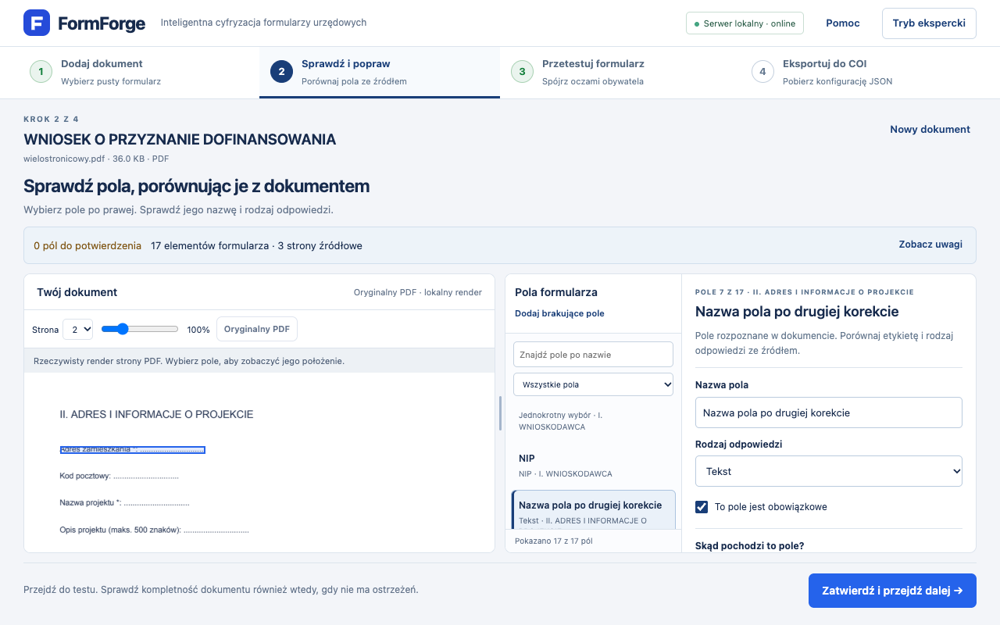

# FormForge COI 1.1 — Smart Workspace

**Od dokumentu do e-formularza.** Cztery oddzielne ekrany: **Dodaj dokument → Sprawdź i popraw → Przetestuj formularz → Eksportuj do COI**. Lokalny konwerter pustych formularzy urzędowych
do COI FormDefinition: upload → analiza → przegląd źródła → edycja → walidacja → JSON.
Pełne narzędzia pozostają w **Tryb ekspercki**; zmiana trybu zachowuje dokument, edycję i odpowiedzi testowe. [Raport UX 1.1](docs/UX_1.1_REPORT.md).



Wydanie 1.1 upraszcza UX. Poniższe metryki rozpoznania pochodzą z zamrożonej ewaluacji 1.0, bez nowego strojenia silnika. Ograniczenia pozostają jawne. **68/69** przekazanych źródeł daje
JSON poprawny w lokalnym schemacie, profilu rekurencyjnym i regułach technicznych.
Nie oznacza to kompletnego rozpoznania. Importer rzeczywistego COI **nie był dostępny**.
Nowe trzy dokumenty R3: mikro F1 surowych pól **52,63% → 58,95%** względem 0.3;
próba mała, jeden anotator. [Pełny raport](docs/FINAL_ACCURACY_REPORT.md).

## Uruchomienie Docker — zalecane

Wymagany działający Docker Desktop/Engine i Compose. Z katalogu projektu
(najlepiej prosty katalog ASCII, np. `FormForge-COI`):

```sh
docker compose build
docker compose up -d --wait
docker compose ps
curl http://127.0.0.1:8000/api/health
```

UI: http://127.0.0.1:8000 · Swagger lokalny: http://127.0.0.1:8000/docs ·
OpenAPI: http://127.0.0.1:8000/openapi.json.

Inny port: `FORMFORGE_HTTP_PORT=8766 docker compose up -d --wait`.
Zatrzymanie: `docker compose down`.
Buildx w badanym macOS odrzucał znormalizowany Unicode w ścieżce. Ten sam kod
zbudowano i uruchomiono przez Compose z tymczasowego katalogu ASCII. W takim
przypadku rozpakuj ZIP do katalogu ASCII; alternatywnie `docker build -t formforge-coi:1.1.0 .`,
a następnie `docker compose up -d --no-build --wait`.

Obraz bazowy oficjalny Python 3.14.5 slim-trixie jest przypięty digestem.
OCR Tesseract 5.5.1 i Leptonica 1.87.0 budowane ze źródeł. Pierwsza instalacja/build
pobiera zależności. Przetwarzanie po instalacji działa bez Internetu.

## Uruchomienie lokalne

Wymagane: Python **3.14**, Tesseract z `pol` i `eng`, ok. 2 GB dostępnej pamięci.
Na macOS z Homebrew: `brew install python@3.14 tesseract tesseract-lang`.
Lokalne pakiety natywne mają własne licencje; rygorystyczny audyt opisuje [raport](docs/LICENSE_COMPLIANCE.md).

```sh
python3.14 -m venv .venv
.venv/bin/python -m pip install -r requirements.lock
.venv/bin/python -m uvicorn formforge.main:app --host 127.0.0.1 --port 8000 --no-access-log
```

Jeśli środowisko zarządzane nie ma pip: `uv pip install --python .venv/bin/python -r requirements.lock`.
Do testów dodatkowo zainstaluj `requirements-dev.lock`, następnie:

```sh
.venv/bin/python -m pytest -q
.venv/bin/python -m ruff check formforge deploy tests scripts
```

Oryginały organizatora nie są potrzebne do działania. Czysty ZIP ich nie zawiera;
W pełnym checkout wykonano 203 testy. Rozpakowana paczka: 188 PASS i 15 jawnych SKIP, ponieważ źródła są osobno dostarczane. Pełne testy
referencji wymagają odtworzenia `reference/coi-official/` z legalnie otrzymanego pakietu.
Nie interpretuj SKIP jako zaliczonego benchmarku.

## Co działa

- PDF: tekst/AcroForm i lokalny OCR skanów; DOCX: tabele, textboxy, kontrolki;
  XLSX/ODS: komórki/scalenia; JPEG/JPE/PNG: OCR z geometrią.
- DOC Word 97–2003: ograniczony bezpieczny odczyt tekstu; bez pełnego składu.
  Starsze, zaszyfrowane, makra lub osadzone obiekty są odrzucane.
- Analiza bloków, etykiet, pól, sekcji i jawnych warunków. Reguły deterministyczne
  oraz opcjonalny mały własny Naive Bayes. Bez LLM ani płatnego API.
- Adapter oficjalnego COI: UUID, MAIN/FINISH, SECTION/repeating, typy, grid,
  walidacja, options, dictionaryName, states, ograniczone JSONata i flow.links.
- Edytor: pola/typy/opcje, obowiązkowość, walidatory, sekcje/grupy, słowniki,
  zależności, potwierdzenia, automatyczna walidacja, cofanie i ponawianie zmian.
- Source mapping PDF/obrazów i odtworzony tekst DOCX/arkuszy. Lokalny eForm
  z warunkami, powtarzaniem i FINISH; nie jest rendererem docelowego COI.
- Zgodność: osobno schema, profil, business rules, błędy i ostrzeżenia, pochodzenie
  uzupełnień standardu. Brak sztucznego „procentu dokładności” w UI.

## Architektura i dane

```text
Browser (własny JS/Jinja, bez CDN)
  → lokalna brama HTTP (stały backend, limity)
  → FastAPI (JWT opcjonalny, limit żądań, semafor)
  → izolowany proces ekstrakcji/OCR (czas/pamięć/temp)
  → layout → pola → model wewnętrzny → adapter COI
  → schema + profil rekurencyjny + reguły techniczne
  → odpowiedź, edytor, eForm, eksport
```

W Compose procesor jest tylko w sieci `internal`, z UID10001, read-only root,
tmpfs, bez capabilities i z limitami zasobów. Brama publikuje wyłącznie localhost.
Nie ma połączeń do usług AI, CDN, zdalnych fontów ani automatycznych pobrań modeli
w runtime. Rzeczywisty test `--network none` sprawdził PDF/DOC/OCR/model lokalny.
OpenTelemetry API jest zależnością przechodnią FastAPI; brak SDK/eksportera.

Źródła są w request-scoped temp i usuwane po zakończeniu/timeout. Podgląd PDF
ponownie przesyła stronę do lokalnego, ograniczonego procesu renderowania; plik
znów jest usuwany. Blob źródła, model, historia edycji i testowe odpowiedzi żyją
w pamięci karty. Nie wpisuj danych obywateli do demonstracji. Brak zapisu wniosków,
podpisu, e-Doręczeń i integracji rejestrów.

## API i konfiguracja

```sh
curl -F 'file=@demo_samples/zaswiadczenie.pdf'   http://127.0.0.1:8000/api/v1/forms/convert > result.json
```

Odpowiedź zawiera `form`, `detected_form`, `export`, `coi_validation`,
`quality_review`, `document`, `stages`. Eksport to `export` z title/tabs/flow.
`POST /api/v1/forms/validate` przyjmuje `{ "form": ... }` i przebudowuje eksport.
`POST /api/v1/forms/coi-validate` sprawdza surowy COI JSON.
`POST /api/v1/forms/preview` zwraca lokalny HTML i JSON.
`POST /api/v1/forms/source-page?page=1` przyjmuje PDF i zwraca PNG.
`GET /api/v1/dictionaries` udostępnia opisy katalogu, bez pełnych wartości COI.
Opcja `export_format=preview` zachowuje dawny jawny format podglądowy.

Wszystkie parametry są w `.env.example`; ustawiane przez środowisko/Compose.
Domyślnie tryb lokalny ma auth=false i binding localhost. Przed udostępnieniem
w sieci włącz JWT, skonfiguruj TLS na kontrolowanej bramie i ogranicz dostęp:
`FORMFORGE_AUTH_ENABLED=true`, sekret >=32 znaki, issuer, audience.
JWT HS256 wymaga exp/iat/sub/iss/aud. Sekrety tylko runtime; nie umieszczaj `.env`
w repo ani obrazie. Limity pliku, komórek, stron, ZIP, obrazu, OCR i czasu pozostają aktywne.

## Demo i dowody

W UI kliknij własny przykład PDF. Otwórz źródło, popraw etykietę pola, sprawdź
eForm i „Zgodność z COI”, pobierz JSON. Każdy przykład przechodzi prawdziwą konwersję.
Na obronie załaduj nowy pusty blankiet i jawnie pokaż konieczne poprawki.

- [Start dla jury](docs/QUICK_START_PL.md) · [Demo 2–3 min](docs/FINAL_DEMO_PL.md)
- [Raport końcowy](docs/FINAL_COMPETITION_REPORT.md) · [Macierz COI](docs/COI_REQUIREMENTS_MATRIX.md)
- [Dokładność](docs/FINAL_ACCURACY_REPORT.md) · [Ograniczenia](docs/KNOWN_LIMITATIONS.md)
- [Prezentacja PDF, 10 slajdów](docs/FormForge_COI_1.0_Presentation_PL.pdf) · [Pytania jury](docs/JURY_QA_PL.md)
- Wyniki pomiarów/QA i generowane konfiguracje: `evaluation/coi-final/`.
  Historyczne eksperymenty w Git zachowane; źródła i duże raw traces pominięte w czystym ZIP.

## Warunki przekazania

Nie deklarujemy pełnej gotowości konkursowej. Nadal potrzebne: rzeczywisty import
COI, poprawki pominiętych pól/warunków na nowym dokumencie, rozstrzygnięcie audytu
natywnych licencji i praw zespołu, nagranie publicznego filmu <=3 min oraz dostęp
jury do repozytorium. Jeżeli repo jest prywatne, właściciel musi nadać dostęp.
Nie zmieniono widoczności ani nie wykonano push/merge.

Kod zachowuje istniejącą [MIT](LICENSE). Materiały organizatora, schemat, źródła
urzędowe i biblioteki mają odrębne prawa; [notices](THIRD_PARTY_NOTICES.md) i
[raport licencyjny](docs/LICENSE_COMPLIANCE.md) opisują zakres. Paczka źródeł nie
zawiera środowiska Python/obrazu Docker: instalację trzeba przeprowadzić wcześniej.
