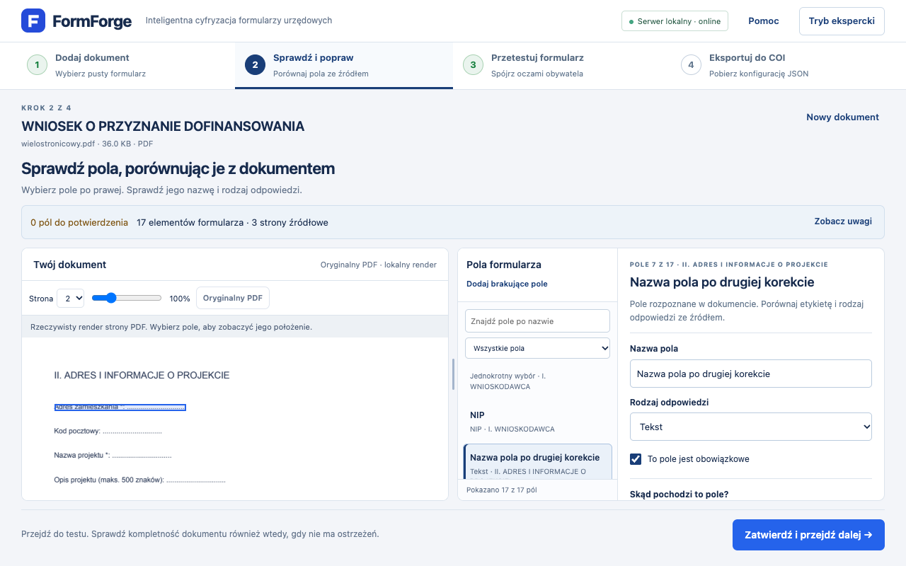

# FormForge 1.1.0 — User First / Smart Workspace

Wydanie rozwija wersję 1.0.0 w gałęzi `feature/ux-simplification`.
Tag `v1.0.0` i historia pozostają zachowane. Nie zmieniono kontraktu COI JSON,
czytników, detektora pól, OCR ani algorytmów mapowania.

## Problem i nowy przebieg

Osiem równorzędnych zakładek i techniczne liczniki zastąpiono czterema oddzielnymi
ekranami. W danym momencie widoczny jest jeden etap, ze stałym headerem, stepperem
i jednoznacznym głównym działaniem:

1. **Dodaj dokument** — informacja o pustym blankiecie, upload, przykład i pomoc.
2. **Sprawdź i popraw** — dokument i edytowalne pola w układzie 50/50.
3. **Przetestuj formularz** — pełny lokalny eForm i fikcyjne odpowiedzi.
4. **Eksportuj do COI** — zakres kontroli, ograniczenia i pobranie JSON.

Duża zakończona karta analizy znika. Timings pozostają w rozwijanym bloku
trybu eksperckiego. Oczekiwanie ma rzeczywisty elapsed time i anulowanie;
nie pokazujemy pozornego procentu ani nieznanego szczegółowego live-stage.



## Układ i dostępność

- Usunięto stałą boczną nawigację. Paleta Smart Workspace:
  Primary #193E78, Action #2563EB, Background #F3F5F9, Surface #FFFFFF,
  Text #172B4D, Muted #64748B, Success #15803D, Warning #D97706, Error #DC2626.
- Systemowy font, lokalne CSS/JS i ikona. Bez CDN i nowych zależności.
- Dzielnik paneli obsługuje pointer drag oraz strzałki / Home / End; granice 30–70%.
  Domyślnie 50/50. Wysokość dopasowuje się do laptopa; przycisk dalszego kroku
  pozostaje widoczny w badanych viewportach 1280×800 i 1440×900.
- Lista pól ma wyszukiwanie, filtry, roving focus i nawigację strzałkami.
  Wybranie pola pokazuje źródło i kompaktowe właściwości: nazwę, typ, obowiązkowość,
  opcje i świadome potwierdzenie. Dodawanie/usuwanie korzysta z istniejącego edytora.
- PDF/obraz pokazują rzeczywisty render/oryginał. Word/arkusze pokazują jawnie
  oznaczony odtworzony tekst/komórki, nie wierny skład źródła.

## Stan danych i edycja

Tryb ekspercki zachowuje wszystkie wcześniejsze zakładki. Przełączanie trybu
przenosi istniejące elementy DOM, bez nowej konwersji i bez czyszczenia odpowiedzi.
Prosty edytor synchronizuje kontrolki kanonicznego edytora; nie tworzy drugiej
niezależnej definicji formularza. Zmiana używa dotychczasowego validate/regenerate.

Działa autowalidacja, cofanie/ponawianie w trybie eksperckim i blokada eksportu
starego wyniku. Edycja wcześniej potwierdzonego pola unieważnia jego potwierdzenie.
Dalszy krok nie potwierdza zbiorczo pozostałych pól.

Zapóźniona odpowiedź walidacji starego dokumentu jest ignorowana po resecie lub
nowym uploadzie. Ta ochrona została sprawdzona z celowo opóźnionym rzeczywistym
żądaniem API. Podgląd zachowuje kompatybilne odpowiedzi i lokalny FileList przy
ponownej walidacji; nowy dokument nie dziedziczy poprzednich wartości.
Zmiana definicji/grupy może odtworzyć powtarzane wiersze; samo przełączenie trybu
zachowuje wiersze i odpowiedzi. Dane preview nigdy nie trafiają do COI export.

## Ostrzeżenia i potwierdzenia

Trzy kategorie: **Wymaga poprawy**, **Wymaga potwierdzenia**, **Informacje**.
Podobne komunikaty są grupowane; lista zawiera wszystkie ich elementy,
a pełna surowa diagnostyka pozostaje w trybie eksperckim. Blokujące błędy nadal
blokują zwykły eksport; istnieje jawnie nazwany szkic z błędami.

Dla uzupełnień standardu widoczny jest tekst:
„Pole dodane na podstawie standardu COI, a nie bezpośrednio odczytane z dokumentu.”
Potwierdzenie dotyczy wyłącznie wskazanego pola i zapisuje istniejące `coi.confirmed`.
Nie usuwa nieobsługiwanej cechy ani nie potwierdza importera. Pierwotny niski
wynik heurystyki może pozostać informacją po ręcznym przeglądzie; jest nadal
widoczny w pełnej diagnostyce.

## Naprawa liczników

`quality_review.metrics` oddziela dokument/surowe wykrycie, model i eksport.
Liczy także rekurencyjne komponenty i stany na sekcjach. Odróżnia użyte słowniki
od wszystkich definicji katalogu oraz pola wejściowe od informacji/kontenerów.

| Scenariusz | Warunki źródłowe | Porównania z polityki COI | Stany w JSON |
|---|---:|---:|---:|
| Własny wielostronicowy PDF | 1 | 0 | 1 SHOW |
| Oficjalny 01 PDF | 0 | 33 | 29 SHOW |
| Oficjalny 05 PDF | 0 | 35 | 31 SHOW |

Jednostki są różne: stan może łączyć kilka porównań. Pochodzenie warunku wynika
z evidence, znaczników polityki COI lub deklaracji modelu, nie tylko z pochodzenia
pola. Reguła standardu na polu odczytanym ze źródła nadal jest regułą standardu.
Ręczne reguły i starsze reguły bez potwierdzonego evidence mają osobne liczniki.
Nie traktujemy stałego readOnly ani bezwarunkowego linku jako dynamicznego stanu.

## Kontrole i wyniki

- Baseline 1.0 przed zmianami: **196 pytest PASS**.
- Kandydat 1.1: **203 pytest PASS**, Ruff i kontrola diff.
- Porównano eksporty czterech tych samych źródeł z zamrożonym baseline 1.0:
  własny PDF, PDF wielostronicowy oraz oficjalne 01/05. Eksporty są identyczne,
  włącznie z deterministycznymi identyfikatorami. To regresja serializacji,
  nie nowe porównanie UUID z oficjalnym referencyjnym JSON.
- Realny Chrome: cztery ekrany, upload, automatyczny krok 2, źródło, label/type,
  potwierdzenie, dynamic visibility, testowe odpowiedzi, eksport i nowy upload.
- Sprawdzono resize pointer/keyboard, oba viewports, brak page overflow,
  dostępność głównej CTA/headera i brak utraty edycji przy zmianie trybu.
- Dodatkowe scenariusze: oficjalne stany 01/05, grupy ostrzeżeń, jeden potwierdzony
  element, blokada błędów i szkic, widoczne ograniczenia eksportu także bez błędów blokujących, add/delete, repeating/FINISH, rejestry bez fikcyjnych
  połączeń, zachowanie FileList, opóźniona walidacja i anulowanie czekania na OCR.
- Zachowane techniczne regresje: smoke, rozbudowany edytor i oficjalne05 przeszły
  po jawnym wejściu w Tryb ekspercki. Zmiana testu potwierdzenia odzwierciedla nową
  zasadę: najpierw edytuj, potem potwierdź. Assertions poprawności pozostają.
- Duży raster 61,9MP przeszedł rzeczywistą konwersję OCR i kontrolę offsetu/source mapping w Docker 1.1; wynik nadal jawnie partial, bez deklaracji trafności wszystkich pól.
- W sprawdzonych przeglądarkowych scenariuszach brak uncaught JS errors i żądań
  do zewnętrznych hostów. Dowody: `evaluation/ux-v11/` i rzeczywiste screenshots.

Docker 1.1 został rzeczywiście zbudowany i uruchomiony z kontekstu ASCII
(obejście znanego problemu Buildx z Unicode). Sprawdzono HTTP formatów,
source-page, UID10001/read-only/internal network i cleanup. Osobny test
`--network none` wykonał PDF/DOC/OCR/model lokalny z wersją1.1. Gotowy runtime
nie potrzebuje Internetu; build/instalacja potrzebują sieci.

Czysta rozpakowana paczka: **188 PASS, 15 jawnych SKIP** dla oddzielnie
udostępnianych oryginałów. UI/API i konwersja PDF z jej źródeł przeszły.
CRC/SHA plików sprawdzone; oryginały organizatora, środowisko i sekrety nie są dołączane.
Końcowy stan i zakres opisuje `evaluation/ux-v11/verification.json`.
Nie używamy historycznych wyników 1.0 jako dowodu nowego builda.

## Wypełniony dokument

Dwa własne blankiety z fikcyjnymi odpowiedziami (AcroForm PDF i tabela DOCX)
sprawdzono w pytest. Nazwa instytucji pozostała w źródle; odpowiedzi nie stały
się etykietami pól ani defaultValue/initial_data. To ograniczony test dwóch
struktur, nie niezawodna anonimizacja dowolnego pliku. Źródło może zawierać
odpowiedzi; nie używaj danych obywateli. Preferowanym wejściem jest pusty blankiet.

## Ograniczenia i wnioski

Automatyczne testy potwierdzają działający przebieg, nie zastępują badania
z pracownikami administracji otwierającymi produkt po raz pierwszy. Nie wykonano
niezależnego human usability study. Przed obroną warto przeprowadzić krótki test
z osobą, która nie zna projektu.

Dokładność rozpoznania i ograniczenia COI z 1.0 nadal obowiązują; nie trenowano
nowego modelu ani nie ogłoszono nowego F1. Rzeczywisty importer, pełne wartości
rejestrów, część zależności i podzbiór DOC pozostają niezweryfikowane/częściowe.
Kwestie licencji/praw zespołu i formalne elementy zgłoszenia są niezależne od UX.

## Uruchomienie

Z prostego katalogu ASCII z rozpakowanym projektem:

```sh
docker compose build
docker compose up -d --wait
```

UI http://127.0.0.1:8000, API/Swagger http://127.0.0.1:8000/docs.
Alternatywa Python3.14 + Tesseract pol/eng:

```sh
python3.14 -m venv .venv
.venv/bin/python -m pip install -r requirements.lock
.venv/bin/python -m uvicorn formforge.main:app --host 127.0.0.1 --port 8000 --no-access-log
```

Pierwsza instalacja/build wymaga sieci; gotowe przetwarzanie jest lokalne.
Parametry bezpieczeństwa/JWT, limity i tymczasowe pliki pozostają aktywne.
